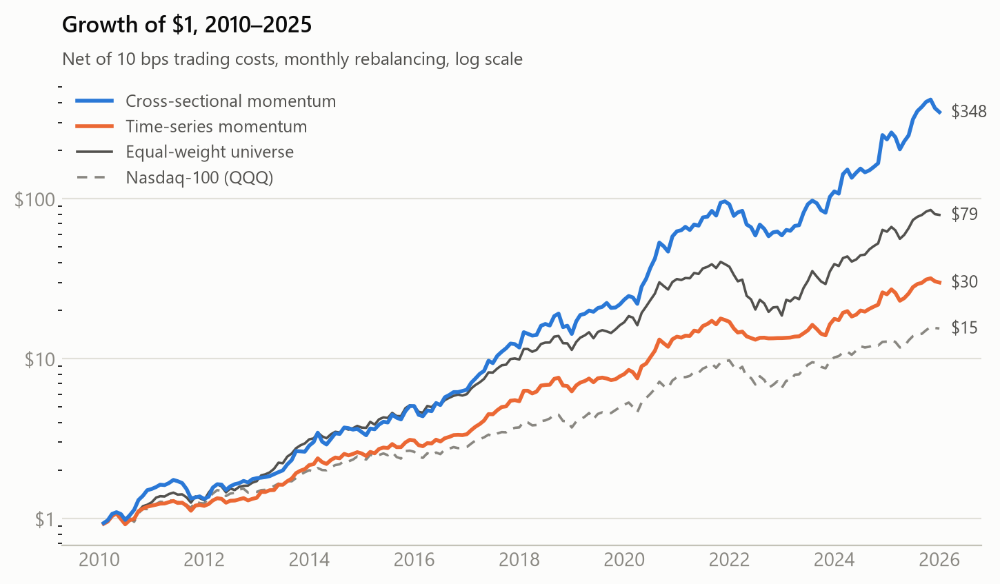
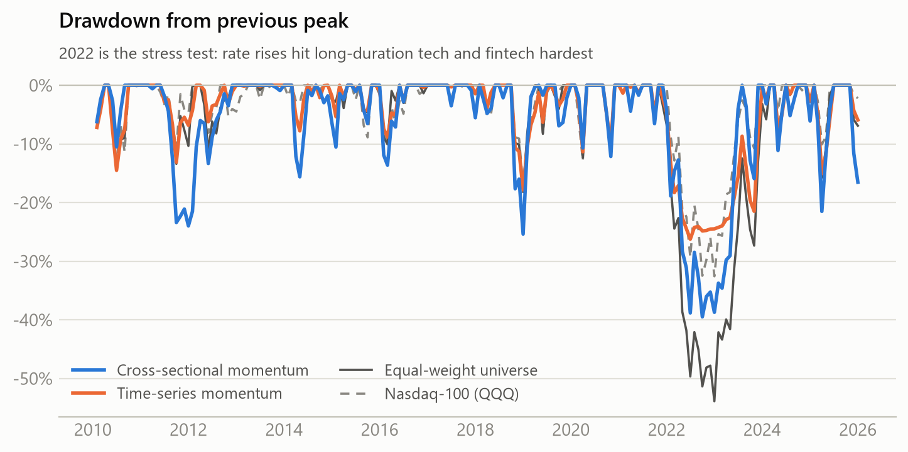
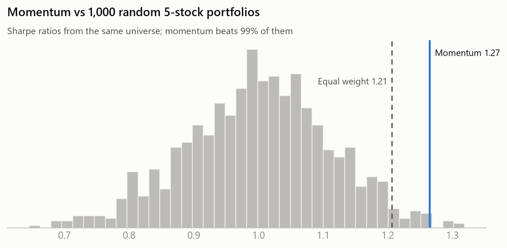
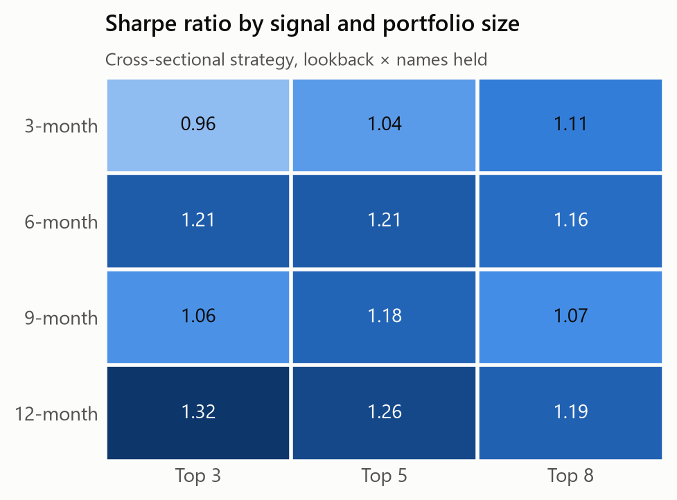

# momentum-backtest

[](https://github.com/cristianahobbs/momentum-backtest/actions/workflows/tests.yml)

Does 12-month price momentum work within big tech and fintech stocks? This repo backtests two classic
momentum rules on 25 US-listed tech and fintech names from 2010 to 2025. It then attacks its own
result in three ways: a random-portfolio placebo, a parameter sweep and a cost sweep.

- **Cross-sectional momentum** (Jegadeesh & Titman, 1993): each month, rank stocks by their return
  from 12 months ago to 1 month ago and hold the top 5, equally weighted.
- **Time-series momentum** (Moskowitz, Ooi & Pedersen, 2012): hold each stock only while its trailing
  12-1 return beats T-bills. Its slot sits in cash otherwise.

Both rules are compared with an equal-weight portfolio of the *same* stocks. That is the fair benchmark,
because it shares the same stock-selection bias (see [Limitations](#limitations)). QQQ and SPY are
included for context.

## Findings

<!-- findings:start -->
Backtest 2010-01 to 2025-12, monthly rebalancing, net of costs. Generated by `python main.py`; raw numbers are in [`output/`](output/).

| | Cross-sectional momentum | Time-series momentum | Equal-weight universe | Nasdaq-100 (QQQ) | S&P 500 (SPY) |
|---|---|---|---|---|---|
| CAGR | 44.2% | 23.7% | 31.4% | 18.7% | 14.0% |
| Volatility | 32.1% | 18.3% | 24.2% | 17.3% | 14.3% |
| Sharpe | 1.27 | 1.18 | 1.21 | 1.00 | 0.90 |
| Sortino | 2.81 | 2.37 | 2.29 | 1.72 | 1.44 |
| Max drawdown | -39.5% | -26.2% | -53.9% | -32.6% | -23.9% |
| Max drawdown window | 2021-11 to 2022-09 | 2021-10 to 2022-06 | 2021-10 to 2022-12 | 2021-12 to 2022-12 | 2021-12 to 2022-09 |
| Worst month | -17.9% | -10.7% | -20.7% | -13.6% | -12.5% |
| Sharpe 2010-17 / 2018-25 | 1.56 / 1.20 | 1.55 / 0.98 | 1.76 / 0.95 | 1.20 / 0.88 | 1.13 / 0.74 |
| Annual turnover | 4.9x | 1.8x | 0.8x | – | – |

- **Cross-sectional** (12-1 momentum, top 5, 10 bps costs): Sharpe 1.27 vs 1.21 for equal-weighting the same stocks. Alpha against that equal-weight universe is 7.5% a year (Newey-West t = 2.07, beta 1.14).
- **Placebo test**: the momentum Sharpe beats 99% of 1,000 portfolios that hold 5 random stocks from the same universe (average random Sharpe 1.00).
- **Time-series** (hold each stock only while its trailing return beats T-bills): max drawdown -26.2% vs -53.9% for the equal-weight universe; Sharpe 1.18.
- **2020 and 2022**: cross-sectional returned 167.5% in 2020 and -36.0% in 2022; QQQ returned 48.4% and -32.6%.
- **Costs**: Sharpe at 0 bps: 1.28, 10 bps: 1.27, 25 bps: 1.24, 50 bps: 1.20.

Historical simulation, not investment advice.
<!-- findings:end -->

<picture>
  <source media="(prefers-color-scheme: dark)" srcset="docs/charts/equity_curve-dark.png">
  
</picture>

<picture>
  <source media="(prefers-color-scheme: dark)" srcset="docs/charts/drawdowns-dark.png">
  
</picture>

### Is it just luck, or just the universe?

The universe of famous tech names already did very well, so any portfolio drawn from it looks good.
The placebo test checks this. It runs 1,000 portfolios that each hold 5 stocks picked at random every
month, using the same universe, rebalancing schedule and costs as the strategy. If momentum adds
nothing, its Sharpe ratio should land in the middle of that distribution.

<picture>
  <source media="(prefers-color-scheme: dark)" srcset="docs/charts/placebo-dark.png">
  
</picture>

### Is it one lucky parameter choice?

A result that only holds for one setting is usually overfit. This grid reruns the strategy for every
combination of lookback (3, 6, 9 or 12 months) and portfolio size (3, 5 or 8 names).

<picture>
  <source media="(prefers-color-scheme: dark)" srcset="docs/charts/robustness-dark.png">
  
</picture>

## Method

| | |
|---|---|
| Data | Monthly dividend- and split-adjusted closes from Yahoo Finance, cached in [`data/prices.csv`](data/prices.csv) |
| Sample | Jan 2010 – Dec 2025 (192 months); signals use prices from 2008 |
| Signal | Return from month t−12 to t−1. The most recent month is skipped to avoid the short-term reversal effect |
| Timing | Weights use closes up to month t and are held through month t+1. A unit test checks that no future price leaks in |
| New listings | A stock enters the universe once it has 12 months of history. Palantir, for example, is eligible from Sept 2021 |
| Costs | 10 bps per unit of weight traded, charged on actual turnover (including drift back to target) |
| Cash | Earns the 13-week T-bill yield (^IRX) |
| Statistics | Sharpe and Sortino on returns in excess of T-bills; alpha vs the equal-weight universe with Newey-West (3 lag) t-stats |

### Universe

| Big tech | Payments and fintech |
|---|---|
| Apple, Microsoft, Amazon, Alphabet, Meta, Nvidia, Tesla, Netflix, Oracle, Adobe, Salesforce, Palantir, Alibaba | Visa, Mastercard, PayPal, Block, Intuit, Shopify, Coinbase, Robinhood, SoFi, Affirm, Nu Holdings, Upstart |

Anthropic, OpenAI and Stripe are excluded because they are private and have no price history.

## Limitations

The biggest problem is **hindsight bias**: the universe was chosen in 2026, from companies we already
know became large. A real investor in 2010 would not have known to own Palantir or Nvidia. Stocks that
faded away are not in the list. LendingClub was going to be included, but its old ticker no longer
returns history, which shows how failed names quietly drop out of free data. As a result, **absolute
returns here are overstated** and should not be compared with a fund's track record.

The comparisons in this repo are built to survive that bias. The equal-weight benchmark and the placebo
portfolios draw from the same flawed universe. So the question being tested is only whether
*ranking by momentum* beats *holding the same stocks without ranking*. A proper test needs a
point-in-time universe, such as all of the Russell 1000 tech and financials constituents as of each date,
including delisted stocks, using CRSP or similar data.

Other simplifications:

- A 25-stock universe holding 5 names is very concentrated, and results depend on a few big winners.
  The 2020 result, for example, comes mostly from Tesla, Shopify and Nvidia.
- Costs are a flat 10 bps. Market impact, borrow costs and taxes are ignored. The strategy is long-only,
  so there is no short leg.
- Monthly data hides intra-month drawdowns.

## Run it

```bash
pip install -r requirements.txt
python main.py               # backtest with cached data; rewrites the Findings section above
python charts.py             # regenerate the charts in docs/charts/
python -m unittest discover -s tests -v

python main.py --refresh                          # re-download prices
python main.py --lookback 6 --top-n 3 --cost-bps 25 --no-readme
```

| File | |
|---|---|
| [`data.py`](data.py) | Universe definition and Yahoo Finance download with on-disk cache |
| [`backtest.py`](backtest.py) | Signals, portfolio simulation with turnover-based costs, performance statistics |
| [`main.py`](main.py) | Runs the strategies, robustness grid, cost sweep and placebo; writes `output/` and the README findings |
| [`charts.py`](charts.py) | Light and dark README charts |
| [`tests/`](tests/) | Offline tests on synthetic data: look-ahead, listing dates, turnover, costs, drawdown, regression |

## References

- Jegadeesh, N. and Titman, S. (1993). Returns to Buying Winners and Selling Losers. *Journal of Finance*.
- Moskowitz, T., Ooi, Y. H. and Pedersen, L. H. (2012). Time Series Momentum. *Journal of Financial Economics*.
- Daniel, K. and Moskowitz, T. (2016). Momentum Crashes. *Journal of Financial Economics*.
